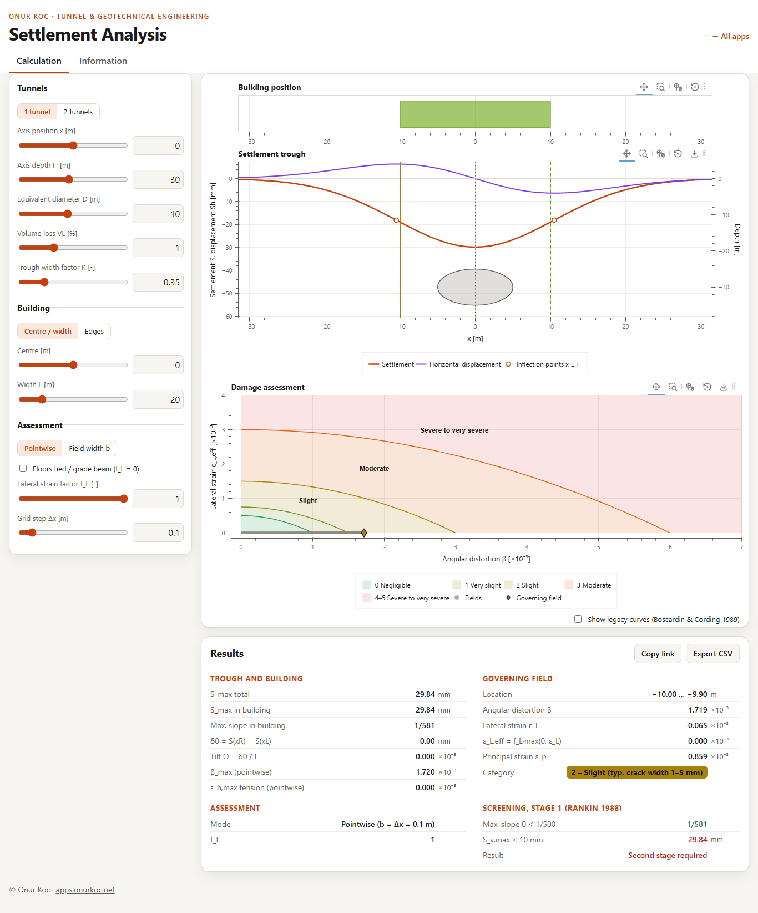
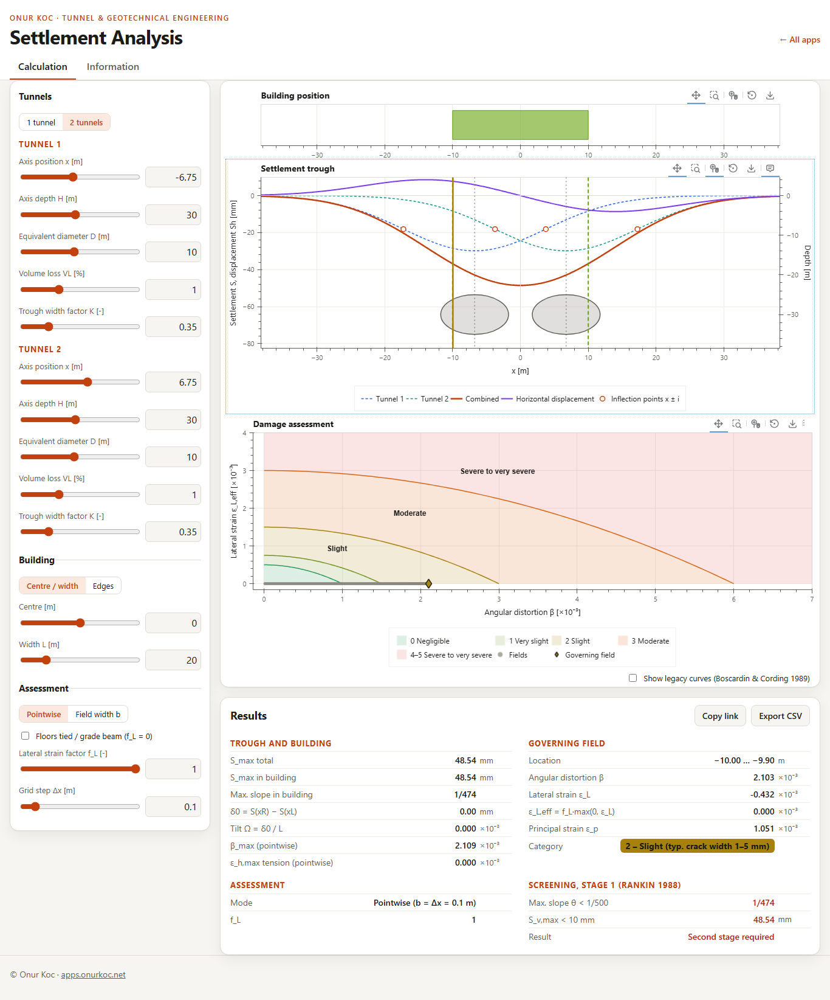
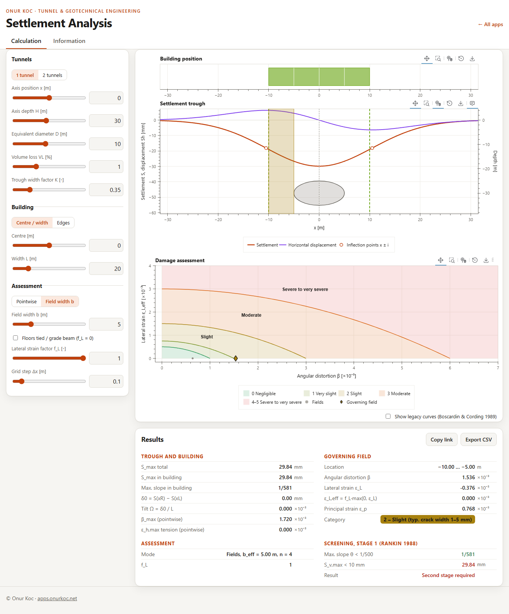
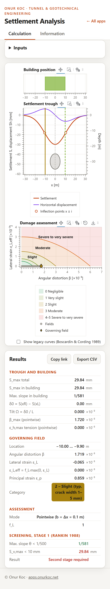
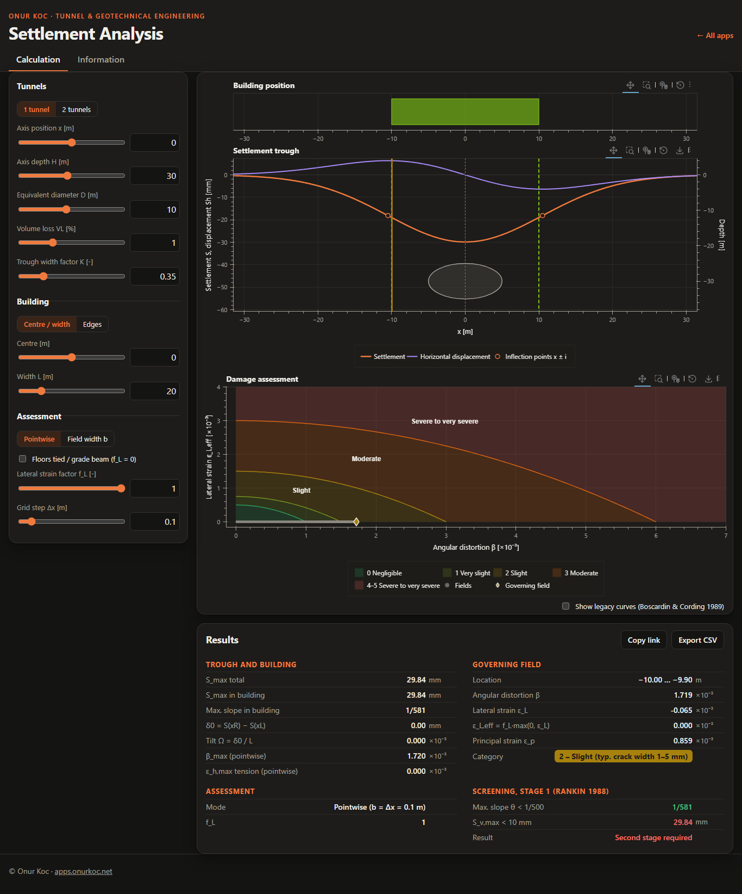

# Settlement Analysis

Browser app for the greenfield settlement trough above one or two
tunnels and the damage assessment of a building with the principal
extension strain criterion of Cording et al. (2010). Everything is
calculated in the browser; there is no server and no data upload.

**Open the app: <https://settlement.onurkoc.net/>** (not yet deployed)

Author: Onur Koc – more apps: <https://apps.onurkoc.net/>

> Estimate for preliminary studies; it does not replace a
> project-specific assessment. Validation status: automated tests and
> an independent numpy reference (below); an independent check by the
> author is pending.



## Scope

- One or two tunnels, each with its own axis position x, axis depth H,
  equivalent diameter D, volume loss VL and trough width factor K.
- Building of width L, given by its centre or by its left/right edge.
- Settlement trough, horizontal displacement, slope 1/n, horizontal
  strain; inflection points.
- Damage assessment of the building: tilt Ω, angular distortion β,
  lateral strain ε_L, principal extension strain ε_p, damage category
  with typical crack width; pointwise or with fields (structural bays)
  of width b; floors tied / grade beam.
- First-stage screening after Rankin (1988).
- CSV export (inputs, results, trough, fields), PNG export of the
  plots, the case in the URL (link to share).

| Two tunnels | Fields b = 5 m | Phone | Dark mode |
| --- | --- | --- | --- |
|  |  |  |  |

## Method

The same formulas are shown in the tab «Information» of the app; the
code is in `app/core/`.

### Settlement trough (`app/core/trough.js`)

Gaussian trough above each tunnel j (Peck 1969; O'Reilly & New 1982),
the troughs of two tunnels superposed. Greenfield, at the ground
surface; settlement S positive downwards, x to the right.

```text
i_j      = K_j · H_j
Smax_j   = VL_j · π·D_j²/4 / (√(2π) · i_j)
S_j(x)   = Smax_j · exp(−(x − x_j)² / (2·i_j²))        S = Σ S_j
S'(x)    = −Σ S_j · (x − x_j) / i_j²                   (analytic)
Sh(x)    = −Σ S_j · (x − x_j) / H_j                    towards each axis, +x positive
eh(x)    = dSh/dx = Σ S_j/H_j · ((x − x_j)²/i_j² − 1)   extension positive
```

The horizontal displacement points to the tunnel axis (O'Reilly & New
1982). Grid step Δx = 0.1 m (adjustable), range ±(max|x_j| + 3·max i_j),
widened to include the building.

### Building and damage (`app/core/building.js`, `app/core/damage.js`)

Building from xL to xR, width L, divided into n = ceil(L/b) fields of
width b_eff = L/n with edges a_k = xL + k·b_eff. «Pointwise»: b = Δx
(the limit b → 0). The building has its own grid from xL to xR, both
edges included.

```text
Ω         = (S(xR) − S(xL)) / L                         tilt
β_k       = |(S(a_k+1) − S(a_k)) / b_eff − Ω|           angular distortion
εL_k      = (Sh(a_k+1) − Sh(a_k)) / b_eff               lateral strain, extension +
εL,eff_k  = f_L · max(0, εL_k)                         compression does not count
εp_k      = εL,eff_k/2 + √((εL,eff_k/2)² + (β_k/2)²)    principal extension strain
```

εp is the maximum over θ of β·sinθ·cosθ + εL·cos²θ, with
tan 2θ = β/εL (Cording et al. 2010, Fig. 3); the derivation is in the
comment of `principalStrain()`. The field with the largest εp governs
(on a tie, the first from the left). β and εL are defined after
Franzius (2003), §2.4.1.

Damage categories (limiting tensile strain εp after Franzius 2003,
Tab. 2.3, after Boscardin & Cording 1989 and Burland 1995; crack widths
after Franzius 2003, Tab. 2.2, and Cording et al. 2010, Fig. 2):

| Category | Degree of severity | εp | Typical crack width |
| --- | --- | --- | --- |
| 0 | Negligible | 0 – 0.05 % | < 0.1 mm |
| 1 | Very slight | 0.05 – 0.075 % | < 1 mm |
| 2 | Slight | 0.075 – 0.15 % | 1–5 mm |
| 3 | Moderate | 0.15 – 0.3 % | 5–15 mm |
| 4–5 | Severe to very severe | ≥ 0.3 % | > 15 mm |

A strain equal to a limit belongs to the higher category. The limit
curves drawn in Cording et al. (2010), Fig. 2 deviate slightly from
these values at the upper two boundaries; the table values are used on
purpose. The crack widths are additional information only: the category
is defined by the ease of repair.

Screening, stage 1 (Rankin 1988, as given by Franzius 2003, §2.4.2.1):
maximum slope θ < 1/500 and maximum settlement S_v,max < 10 mm at the
building ⇒ negligible risk of damage; otherwise a second stage
assessment is required.

The limit parabolas of the earlier apps (Boscardin & Cording 1989) can
be shown for comparison («Show legacy curves»); they are not used for
the category.

## Assumptions

- Greenfield movements, no interaction between ground and building; the
  building follows the trough.
- Tilt = slope of the chord over the whole building (beam assumption,
  Cording et al. 2010, Fig. 5b). If the distortion concentrates in one
  bay and the rest of the building only tilts (Fig. 5a), the real tilt
  is smaller and β is underestimated; Cording et al. report β between
  2Δ/L (Fig. 5b) and 4Δ/L (Fig. 5a).
- A field width is needed: with one field over the whole building
  (b = L) the field slope equals the tilt and β = 0.
- Only extension counts; compressive lateral strain is set to zero.
- f_L reduces the lateral strain; f_L = 0 for floors tied to the walls
  or a grade beam (Cording et al. 2010, Fig. 2), then εp = β/2.
- Not included: subsurface trough at foundation level, longitudinal
  trough, deflection ratio method.

## Validation

- `tests/reference/make_reference.py`: independent numpy
  implementation of the formulas above → `reference.json` (8 cases: one
  tunnel with the building over the axis, outside the trough, over the
  inflection point and on the flank; two symmetric tunnels; two tunnels
  with different H, D, VL, K; each pointwise, with b = 5 m and with
  f_L = 0). The JavaScript core matches with a relative tolerance of
  1e-9.
- Invariants: trough volume = VL·πD²/4, S' and εh against finite
  differences, symmetry, εh = 0 at x_j ± i_j, εp against a numerical
  maximum over θ, limit curves at constant εp, convergence of the
  fields to the pointwise values, b = L ⇒ β = 0, f_L = 0 ⇒ εp = β/2.
- `tests/reference/legacy_curves.json`: the limit curves of the earlier
  Bokeh app; `legacyCurves()` matches them to 1e-12.
- `tests/legacy.test.js`: records the errors of the earlier apps and the
  difference to the corrected values (see
  [docs/LEGACY_NOTES.md](docs/LEGACY_NOTES.md), in German).
- `tests/browser/check.mjs`: headless check in Microsoft Edge (console,
  requests, results against the core, alignment of the axes, phone
  layout, dark mode, PNG export, tab «Information»).

Not yet done: an independent check by the author with other programs
(the CSV export is meant for it).

## Development

- Static app in `app/`, served as it is: no build step, no framework,
  no server. Vanilla JavaScript (ES modules), JSDoc types,
  `// @ts-check` in every file (`jsconfig.json`).
- Structure:
  - `app/core/` calculation core without DOM: `trough.js`,
    `building.js`, `damage.js`, `units.js`
  - `app/state.js` defaults, validation, URL hash; `app/model.js`
    results; `app/csv.js` export; `app/info.js` tab «Information»
  - `app/ui/` input form and result panel; `app/plots/` one module per
    plot (BokehJS 3.10.1)
  - `app/vendor/` BokehJS and KaTeX, see
    [app/vendor/README.md](app/vendor/README.md)
- Tests (Node 20 or newer):

  ```sh
  npm test
  ```

- Browser check (Microsoft Edge, headless; writes the screenshots in
  `docs/screenshots/web/`):

  ```sh
  node tests/browser/check.mjs
  ```

- Local server: `python serve.py` (or `start.cmd` on Windows), then
  <http://localhost:8000/>.
- Python: Anaconda at `C:\ProgramData\anaconda3\python.exe` (needs
  numpy; scipy is not used).
  - `python tests/reference/make_reference.py` writes `reference.json`.
  - `python tests/reference/extract_legacy.py` writes
    `legacy_curves.json`; it needs the earlier apps in `legacy/`, which
    are kept locally only.
- Deployment on Cloudflare Pages: [DEPLOY.md](DEPLOY.md) (in German).

## Sources

- Boscardin, M.D., Cording, E.J. (1989): Building response to
  excavation-induced settlement. Journal of Geotechnical Engineering
  115(1), 1–21.
- Burland, J.B. (1995): Assessment of risk of damage to buildings due to
  tunnelling and excavation. Invited special lecture, 1st Int. Conf. on
  Earthquake Geotechnical Engineering, IS-Tokyo '95.
- Cording, E.J., Long, J.L., Son, M., Laefer, D., Ghahreman, B. (2010):
  Assessment of excavation-induced building damage. Earth Retention
  Conference 3, ASCE, doi:10.1061/41128(384)7.
- Franzius, J.N. (2003): Behaviour of buildings due to tunnel induced
  subsidence. PhD thesis, Imperial College London.
- Mair, R.J., Taylor, R.N., Burland, J.B. (1996): Prediction of ground
  movements and assessment of risk of building damage due to bored
  tunnelling. Geotechnical Aspects of Underground Construction in Soft
  Ground, Balkema, Rotterdam, 713–718.
- O'Reilly, M.P., New, B.M. (1982): Settlements above tunnels in the
  United Kingdom – their magnitude and prediction. Tunnelling '82,
  Institution of Mining and Metallurgy, London.
- Peck, R.B. (1969): Deep excavations and tunnelling in soft ground.
  7th Int. Conf. on Soil Mechanics and Foundation Engineering, Mexico
  City, State of the art volume, 225–290.
- Rankin, W.J. (1988): Ground movements resulting from urban
  tunnelling: predictions and effects. Engineering geology of
  underground movements, The Geological Society, London, 79–92.

Typical values of K in the tab «Information» as listed in the GEO5
online help (Fine Ltd., «Shape of subsidence trough»).

## Legacy

The app replaces two earlier Bokeh 2.3.1 apps. They are not part of
this repository; their functions and the errors corrected here are
documented in [docs/LEGACY_NOTES.md](docs/LEGACY_NOTES.md).

## License

MIT, see [LICENSE](LICENSE). Third-party libraries in `app/vendor/`
keep their own licenses (BokehJS: BSD-3-Clause, KaTeX: MIT).
